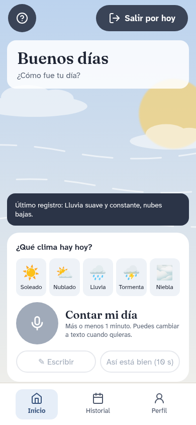
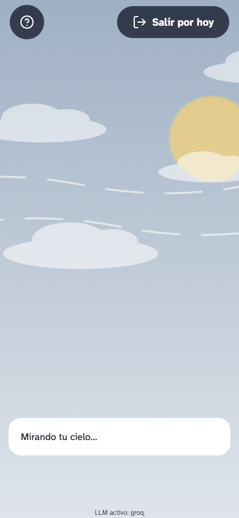
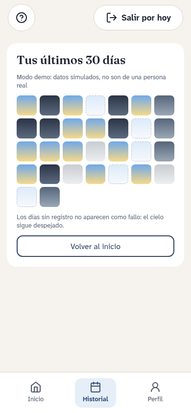
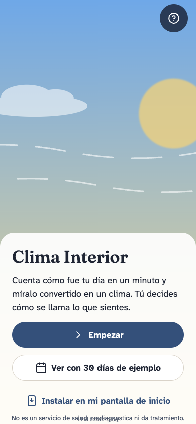
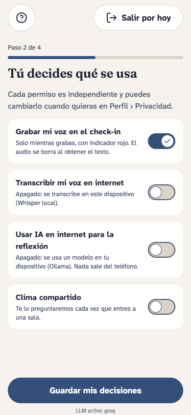
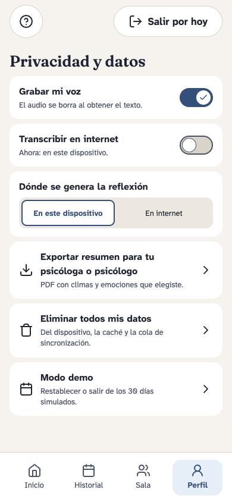
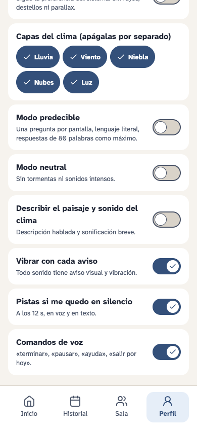

# Clima Interior · diario emocional generativo

Cuenta cómo fue tu día en un minuto y míralo convertido en un clima. La app te propone palabras para lo que
sientes, y tú decides cuáles son tuyas.

Proyecto del curso **CC451 Interacción Humano-Computador**, Universidad Nacional de Ingeniería, 2026-2.
**Grupo 8:** Melissa Iman Noriega · Benjamin Seminario Serna · Ivett Mera Amado.

| Inicio | Emociones propuestas | Historial demo |
|---|---|---|
|  |  |  |

| Primer uso | Permisos por separado | Privacidad y datos | Accesibilidad |
|---|---|---|---|
|  |  |  |  |

## Qué hace

0. La primera vez pasas por cinco pasos: bienvenida, edad, permisos por separado, límites no clínicos y ajustes iniciales de accesibilidad. Nada sale del dispositivo antes del permiso correspondiente.
1. Eliges el clima del día: soleado, nublado, lluvia, tormenta o niebla. Si no tienes ganas de hablar, con eso basta.
2. Si quieres, lo cuentas por voz o lo escribes. Puedes corregir la transcripción antes de que la lea la IA.
3. Antes de llamar a la IA se revisa si hay frases de riesgo. Si las hay, la app muestra la Línea 113 (opción 5), el SAMU 106 y la PNP 105, y no genera reflexión.
4. La IA propone emociones y tú eliges las tuyas o marcas "no sé". Lo que infiere la IA no reemplaza lo que eliges.
5. Ves una reflexión corta, que también se puede escuchar.
6. El historial de ejemplo muestra 30 días simulados.
7. En **Perfil** ves lo que la app sabe de ti y apagas cada dato, cambias los permisos, exportas un resumen en PDF para tu psicóloga o psicólogo, o eliminas todos tus datos.
8. En **Accesibilidad** activas movimiento reducido, apagas cada capa del clima, y eliges el modo predecible o el neutral, la descripción hablada del paisaje, la vibración, las pistas y las órdenes de voz.

## Requerimientos del proyecto y dónde están

| Requerimiento | Cómo se cumple | Estado |
|---|---|---|
| Interfaz de voz | STT y TTS con Web Speech API (`src/voz/stt.js`) | Hecho |
| LLM con capa de abstracción | Contrato común + proveedores `mock`, `ollama`, `remoto` (`src/llm/`) | Hecho |
| PWA | `vite-plugin-pwa`: instalable, service worker, offline | Hecho |
| Personalización continua | Perfil persistente con registros y hora habitual (`src/datos/perfil.js`) | Básico |
| Multiusuario | Salas por código con Supabase Realtime; datos de ejemplo en `public/demo/sala-ejemplo.json` | Diseñado |
| Diseño emocional (Norman) | Visceral: paisaje vivo. Conductual: check-in en menos de 90 s y micro-interacciones. Reflexivo: historial y patrones | Parcial |
| Primer uso y consentimiento | Edad, cuatro permisos independientes y límites no clínicos (`src/pantallas/PrimerUso.jsx`) | Hecho |
| Privacidad y datos | Permisos, qué datos usa la personalización, exportar PDF y eliminar todo (`src/pantallas/Privacidad.jsx`, `Datos.jsx`) | Hecho |
| Accesibilidad | Movimiento reducido, capas, modos predecible y neutral, voz, vibración (`src/pantallas/Accesibilidad.jsx`) | Hecho |

La matriz de trazabilidad completa (44 RF, 32 RNF, 32 historias de usuario) está en
[`docs/matriz-trazabilidad.md`](docs/matriz-trazabilidad.md).

## Instalación

Requisitos: **Node.js 20 o superior** y **Python 3** (solo si quieres regenerar los datos simulados).

```bash
git clone https://github.com/Melissa1221/clima-interior.git
cd clima-interior
npm install
cp .env.example .env      # por defecto usa el proveedor simulado, sin claves
npm run dev               # http://localhost:5173
npm test                  # pruebas de la capa LLM, el riesgo, el perfil, la privacidad, la exportación y la accesibilidad
```

Para probar la PWA instalable y el modo offline, usa la versión compilada:

```bash
npm run build
npm run preview           # http://localhost:4173
```

En Chrome aparece el botón **Instalar** en la barra de direcciones. En el celular, abre la URL y elige
"Agregar a pantalla de inicio". El dictado por voz necesita Chrome o Edge; en otros navegadores la app
ofrece escribir.

### Cambiar de proveedor de LLM

Edita `VITE_LLM_PROVIDER` en `.env`:

| Valor | Qué usa | Necesita |
|---|---|---|
| `mock` | Respuestas simuladas por reglas | Nada (por defecto) |
| `gemini` | Gemini Flash por API (capa gratuita) | `VITE_GEMINI_API_KEY` de [AI Studio](https://aistudio.google.com/apikey) |
| `ollama` | Modelo local | [Ollama](https://ollama.com) con `ollama pull llama3.2` |
| `remoto` | Cualquier API vía proxy | `VITE_REMOTO_URL` apuntando al proxy que guarda la clave |

Si el proveedor falla, tarda más de 10 s o responde fuera del esquema, la app usa una reflexión local y sigue funcionando.

## Datos simulados

`public/demo/` contiene 30 días (8 sep – 7 oct 2026) de una persona ficticia y una sala de ejemplo con 5
seudónimos. No hay datos reales. Para regenerarlos (semilla fija, siempre salen iguales):

```bash
npm run datos
```

## Despliegue

La app es estática (`npm run build` genera `dist/`) y se publica en Vercel con `vercel.json`: caché larga para los archivos con hash, sin caché para `sw.js` y el manifiesto, para que cada versión nueva llegue sola.

```bash
npx vercel login          # una vez, con tu cuenta
npx vercel deploy --prod  # publica la versión de producción
```

La versión pública usa el proveedor `mock` (sin claves). Una clave de Gemini en `VITE_GEMINI_API_KEY` quedaría dentro del bundle y visible para cualquiera: para usar una IA remota hay que ponerla detrás de un proxy (`VITE_REMOTO_URL`). Para despliegues automáticos por cada PR, conecta el repositorio desde el panel de Vercel.

Comprobado sobre la versión compilada: se instala como PWA y, tras la primera visita, funciona sin conexión, incluida la pantalla de ayuda en crisis.

## Reporte de trazabilidad

[`docs/reporte-trazabilidad.md`](docs/reporte-trazabilidad.md) (también en [PDF](docs/reporte-trazabilidad.pdf)) une cada una de las 32 historias de usuario con los requerimientos que cubre, el código que los implementa (enlaces a la línea), las pruebas y una captura. Hoy: 35 de 76 requerimientos implementados, 18 parciales y 23 pendientes; el reporte explica cada hueco.

```bash
npm run capturas   # regenera docs/capturas recorriendo la app en un navegador real (Chrome o Chromium)
npm run reporte    # regenera el reporte y su PDF, y el estado de la matriz; falla si un enlace ya no coincide con el código
```

Los datos de partida son `docs/historias-de-usuario.json`, `docs/trazabilidad-codigo.json` y la [matriz](docs/matriz-trazabilidad.md). Al cambiar el código, se actualiza `trazabilidad-codigo.json` y se vuelve a correr `npm run reporte`.

## Video

El guion está en [`docs/video/guion.md`](docs/video/guion.md) y los subtítulos en `docs/video/guion.srt`. El video se arma solo con la app real, sin narración; el grupo graba la voz de cada escena.

```bash
npm run video:grabar   # graba los clips con la app compilada y genera las placas (video-salida/)
npm run video:montar   # monta video-salida/clima-interior.mp4 con subtítulos; mezcla video-salida/narracion/NN.m4a si existe
```

Necesita Chrome o Chromium y `ffmpeg`. `npx playwright-core install ffmpeg` baja el ffmpeg que usa Playwright para grabar.

## Documentación

- [Arquitectura (C4), con diagrama de despliegue](docs/arquitectura.md)
- [Reporte de trazabilidad](docs/reporte-trazabilidad.md) y su [PDF](docs/reporte-trazabilidad.pdf)
- [Matriz de trazabilidad](docs/matriz-trazabilidad.md)
- Prototipo de fidelidad media en Figma: *Clima Interior · MVP* (58 pantallas). Ya están programadas S01 a S05 (primer uso), S07, S40, S42 a S45 (privacidad) y S46 a S49 (accesibilidad)

## Estructura

```
src/
  App.jsx            flujo del check-in, historial y navegación entre pantallas
  componentes/       paisaje, íconos del Figma y piezas del sistema de diseño (botón, aviso, fila de ajuste…)
  pantallas/         primer uso, privacidad, exportar y eliminar, accesibilidad
  iconos/            íconos SVG de 24 px exportados del Figma
  llm/               contrato, proveedores e índice con respaldo local
  voz/stt.js         voz a texto (local o en internet según el permiso) y texto a voz
  datos/perfil.js    perfil persistente: registros, permisos, ajustes y borrado total
  datos/privacidad.js reglas de consentimiento para dictar
  datos/exportar.js  resumen y PDF sin dependencias
  datos/accesibilidad.js órdenes de voz, vibración, límite de palabras y sonificación
  datos/riesgo.js    detector de riesgo y líneas de ayuda
  estilos.css, componentes.css, microinteracciones.css  tokens del Figma, componentes y animaciones
public/demo/         datos simulados
scripts/             datos simulados, capturas, reporte de trazabilidad y video
docs/                arquitectura, matriz, reporte, capturas y guion del video
```

## Aviso

Clima Interior no es un servicio de salud mental ni reemplaza a un profesional. Si estás en riesgo, llama a la
**Línea 113, opción 5**.

## Licencia

[MIT](LICENSE)
