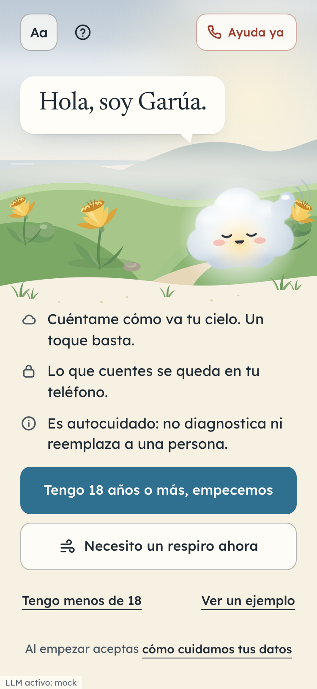
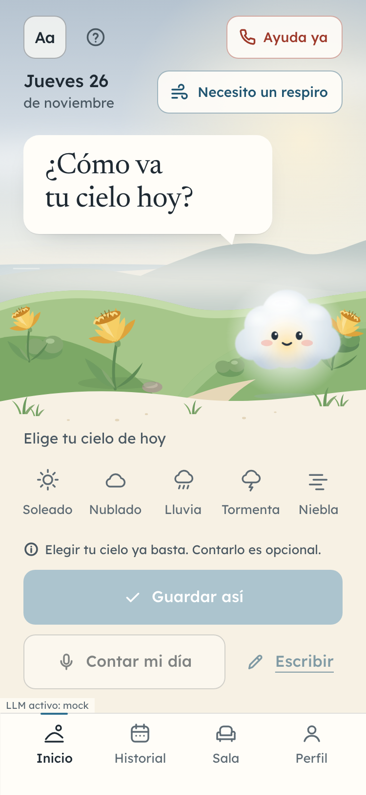
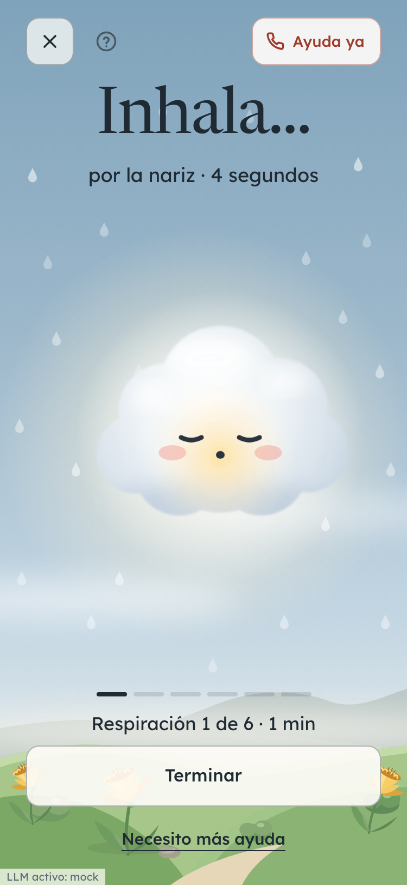
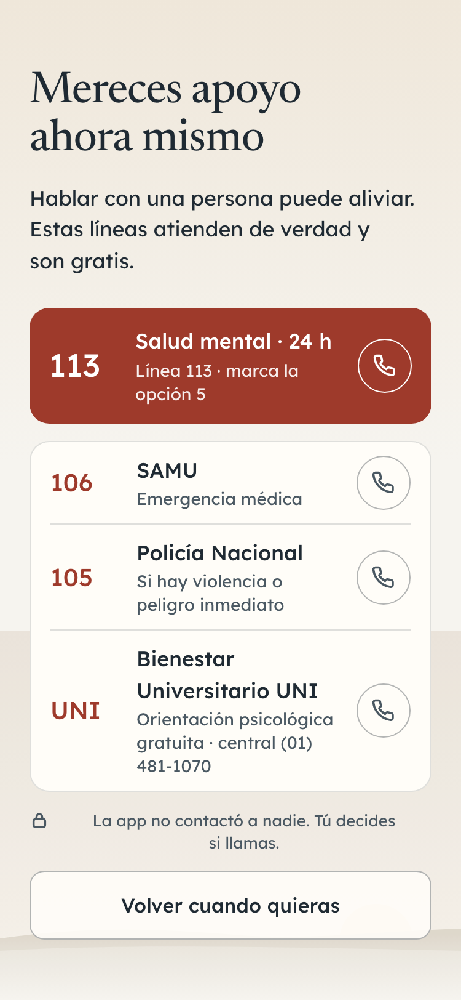
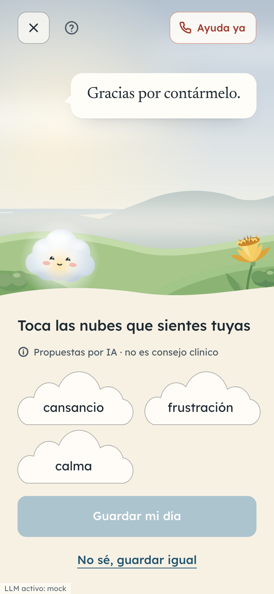
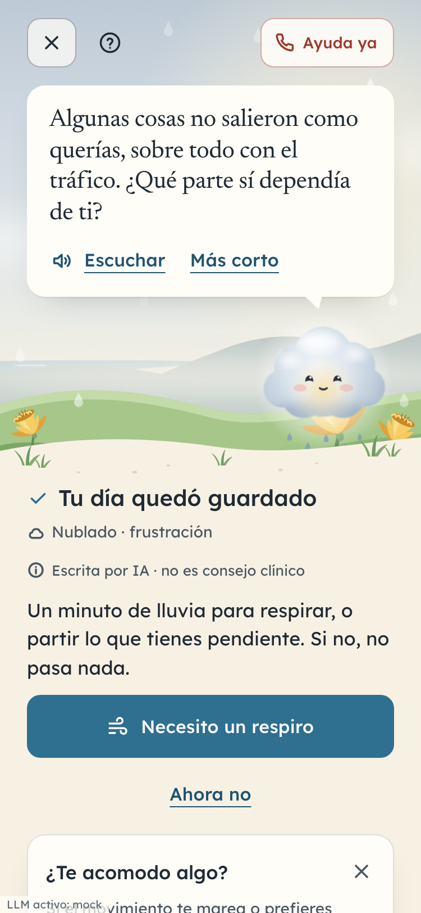
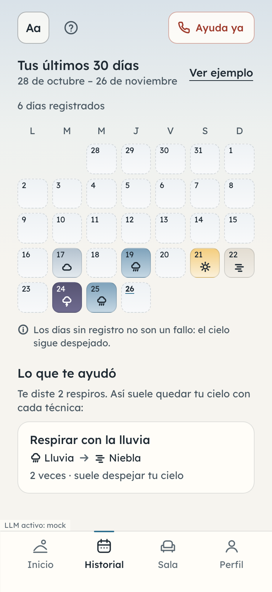
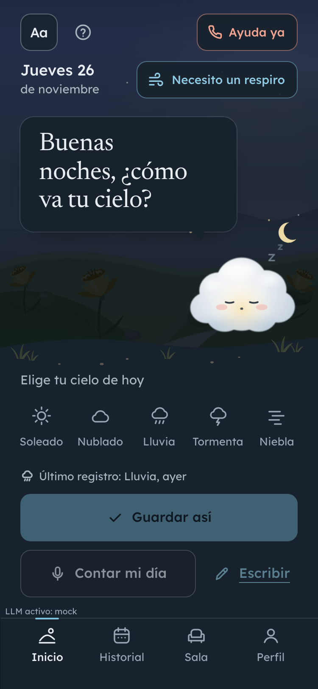

# Clima Interior · diario emocional generativo

Cuenta cómo fue tu día en un minuto y míralo convertido en un clima. La app te propone palabras para lo que
sientes, y tú decides cuáles son tuyas.

Proyecto del curso **CC451 Interacción Humano-Computador**, Universidad Nacional de Ingeniería, 2026-2.
**Grupo 8:** Melissa Iman Noriega · Benjamin Seminario Serna · Ivett Mera Amado.

**App publicada:** https://clima-interior.vercel.app (se instala como PWA y funciona sin conexión).

| Bienvenida | Inicio | Respiro | Ayuda ya |
|---|---|---|---|
|  |  |  |  |

| Emociones | Reflexión guardada | Historial | De noche |
|---|---|---|---|
|  |  |  |  |

Las 39 pantallas del sistema visual v3 a 375 × 812 están en [`docs/capturas/v3/`](docs/capturas/v3/).

## Qué hace

0. **Primer uso en una pantalla.** La bienvenida dice lo esencial en tres líneas (lo que cuentas se queda en tu teléfono, Garúa no diagnostica ni reemplaza a una persona) y un toque declara la edad; quien tiene menos de 18 ve una pantalla propia para leerla con un adulto. Los cuatro permisos arrancan apagados y se piden **justo a tiempo**: el micrófono la primera vez que tocas «Contar mi día», la IA en internet la primera vez que va a leer tu relato, y una tarjeta «¿Te acomodo algo?» ofrece los ajustes de accesibilidad tras el primer día guardado. «Necesito un respiro», «Ayuda ya» y el ejemplo de 30 días funcionan sin pasar por la bienvenida.
   - **Ayuda ya** está arriba a la derecha en todas las pantallas: a un toque, las líneas 113, 106, 105 y Bienestar UNI, sin que la app contacte a nadie.
   - **Aa**, arriba a la izquierda, abre el tamaño del texto, menos movimiento y sin tormentas.
1. Eliges el clima del día: soleado, nublado, lluvia, tormenta o niebla, y tocas «Guardar así». Si no tienes ganas de hablar, con eso basta.
2. Si quieres, lo cuentas por voz o lo escribes. Puedes corregir la transcripción antes de que la lea la IA.
3. Antes de llamar a la IA se revisa si hay frases de riesgo. Si las hay, la app muestra la Línea 113 (opción 5), el SAMU 106 y la PNP 105, y no genera reflexión.
4. La IA propone emociones y tú eliges las tuyas o marcas "no sé". Lo que infiere la IA no reemplaza lo que eliges.
5. Ves una reflexión corta, que también se puede escuchar.
6. El historial de ejemplo muestra 30 días simulados.
7. En **Perfil** ves lo que la app sabe de ti y apagas cada dato, cambias los permisos, exportas un resumen en PDF para tu psicóloga o psicólogo, o eliminas todos tus datos.
8. **Necesito un respiro** (en el inicio, gratis y a un toque; también se ofrece tras un día de lluvia o tormenta): empieza a respirar con Garúa tras una cuenta de 3 s, sin preguntas antes; al final, «¿Cómo quedaste?» es opcional. Son herramientas de autocuidado de 1 a 3 minutos, no terapia. Respirar con la lluvia (respiración lenta o suspiro cíclico), 5-4-3-2-1, partir la tarea y «¿qué le dirías a una amiga?». Si lo respondes, guarda solo el clima de antes y de después, y en el historial «Lo que te ayudó» resume cada técnica. Si el relato tiene una trampa de pensamiento, la app la pregunta («¿Puede ser que…?»), nunca la afirma; si hay riesgo, solo aparece la pantalla de crisis.
9. En **Accesibilidad** eliges el tamaño del texto y el tema (automático, claro o noche: de noche el cielo se oscurece), activas movimiento reducido, apagas cada capa del clima, y eliges el modo predecible o el neutral, la descripción hablada del paisaje, la vibración, las pistas y las órdenes de voz.

## Requerimientos del proyecto y dónde están

| Requerimiento | Cómo se cumple | Estado |
|---|---|---|
| Interfaz de voz | STT y TTS con Web Speech API (`src/voz/stt.js`) | Hecho |
| LLM con capa de abstracción | Contrato común + proveedores `mock`, `ollama`, `remoto` (`src/llm/`) | Hecho |
| PWA | `vite-plugin-pwa`: instalable, service worker, offline | Hecho |
| Personalización continua | El perfil aprende hora habitual, duración, emociones que eliges, si la IA acierta, fallos del micrófono y el largo de reflexión que prefieres; cada cambio anota su motivo y se puede apagar o borrar en «Lo que sabe de ti» (`src/datos/perfil.js`, `src/pantallas/Privacidad.jsx`) | Hecho |
| Multiusuario | Salas de clima compartido con código de 128 bits, seudónimos efímeros, clima colectivo, retirar, sacar y cerrar. Mensajes solo numéricos validados en cliente y servidor (`src/salas/`, `server/salas.mjs`) | Hecho |
| Diseño emocional (Norman) | Visceral: el mundo ilustrado de Lima y Garúa, la nube que acompaña. Conductual: check-in en menos de 90 s y micro-interacciones. Reflexivo: historial y patrones | Parcial |
| Primer uso y consentimiento | Bienvenida única con edad y pantalla para menores; cuatro permisos apagados que se piden justo a tiempo (`src/pantallas/Bienvenida.jsx`, `src/pantallas/Hojas.jsx`, `src/datos/privacidad.js`) | Hecho |
| Privacidad y datos | Permisos, qué datos usa la personalización, exportar PDF y eliminar todo (`src/pantallas/Privacidad.jsx`, `Datos.jsx`) | Hecho |
| Accesibilidad | Movimiento reducido, capas, modos predecible y neutral, voz, vibración (`src/pantallas/Accesibilidad.jsx`) | Hecho |

La matriz de trazabilidad completa (45 RF, 32 RNF, 33 historias de usuario) está en
[`docs/matriz-trazabilidad.md`](docs/matriz-trazabilidad.md).

## Instalación

Requisitos: **Node.js 20 o superior** y **Python 3** (solo si quieres regenerar los datos simulados).

```bash
git clone https://github.com/Melissa1221/clima-interior.git
cd clima-interior
npm install
cp .env.example .env      # por defecto usa el proveedor simulado, sin claves
npm run dev               # http://localhost:5173
npm test                  # pruebas unitarias: capa LLM, riesgo, perfil, privacidad, exportación, accesibilidad y salas
npx playwright install chromium   # solo la primera vez
npm run e2e               # pruebas e2e: flujos completos, salas entre dispositivos, WCAG 2.2 AA y PWA offline
```

Para probar la PWA instalable y el modo offline, usa la versión compilada:

```bash
npm run build
npm run preview           # http://localhost:4173
```

En Chrome aparece el botón **Instalar** en la barra de direcciones. En el celular, abre la URL y elige
"Agregar a pantalla de inicio". El dictado por voz necesita Chrome o Edge; en otros navegadores la app
ofrece escribir.

### Salas de clima compartido

Sin configurar nada, las salas funcionan entre pestañas del mismo navegador (modo demo). Para usarlas entre
dispositivos, levanta el relé y apunta la app a él:

```bash
npm run salas                                   # relé WebSocket en ws://localhost:8787
echo "VITE_SALAS_URL=ws://localhost:8787" >> .env
npm run dev -- --host                           # para abrirla también desde el celular en la misma red
```

En el celular usa `ws://<IP de la laptop>:8787` en `VITE_SALAS_URL`. El relé no guarda diarios ni texto: solo
reenvía mensajes numéricos entre quienes tienen el mismo código y borra la sala al cerrarla o a las 24 h.

### Cambiar de proveedor de LLM

Edita `VITE_LLM_PROVIDER` en `.env`:

| Valor | Qué usa | Necesita |
|---|---|---|
| `mock` | Respuestas simuladas por reglas | Nada (por defecto) |
| `gemini` | Gemini Flash por API (capa gratuita) | `VITE_GEMINI_API_KEY` de [AI Studio](https://aistudio.google.com/apikey) |
| `groq` | gpt-oss-120b por API (capa gratuita) | `VITE_GROQ_API_KEY` de [Groq](https://console.groq.com/keys) |
| `ollama` | Modelo local | [Ollama](https://ollama.com) con `ollama pull llama3.2` |
| `remoto` | Cualquier API vía proxy | `VITE_REMOTO_URL` apuntando al proxy que guarda la clave |

Si el proveedor falla, tarda más de 10 s o responde fuera del esquema, la app usa una reflexión local y sigue funcionando.

## Datos simulados

`public/demo/` contiene 30 días (8 sep – 7 oct 2026) de una persona ficticia y una sala de ejemplo con 5
seudónimos. No hay datos reales. Para regenerarlos (semilla fija, siempre salen iguales):

```bash
npm run datos
```

## Despliegue

La app es estática (`npm run build` genera `dist/`) y se publica en Vercel con `vercel.json`: caché larga para los archivos con hash, sin caché para `sw.js` y el manifiesto, para que cada versión nueva llegue sola.

```bash
npx vercel login          # una vez, con tu cuenta
npx vercel deploy --prod  # publica la versión de producción
```

La versión pública usa el proveedor `mock` (sin claves). Una clave de Gemini en `VITE_GEMINI_API_KEY` quedaría dentro del bundle y visible para cualquiera: para usar una IA remota hay que ponerla detrás de un proxy (`VITE_REMOTO_URL`). Para despliegues automáticos por cada PR, conecta el repositorio desde el panel de Vercel.

Comprobado en https://clima-interior.vercel.app: el service worker toma el control, el manifiesto es válido, las fuentes cargan y, tras la primera visita, funcionan sin conexión la bienvenida, la demo de 30 días y la pantalla de ayuda en crisis (aparece en menos de 1 s).

## Reporte de trazabilidad

[`docs/reporte-trazabilidad.md`](docs/reporte-trazabilidad.md) (también en [PDF](docs/reporte-trazabilidad.pdf)) une cada una de las 33 historias de usuario con los requerimientos que cubre, el código que los implementa (enlaces a la línea), las pruebas y una captura. Hoy: 46 de 77 requerimientos implementados, 20 parciales y 11 pendientes; el reporte explica cada hueco.

```bash
npm run capturas   # regenera docs/capturas/v3 (375 × 812) con su propio Vite en el puerto 5182 y el Chromium de Playwright
npm run reporte    # regenera el reporte y su PDF, y el estado de la matriz; falla si un enlace ya no coincide con el código
```

Los datos de partida son `docs/historias-de-usuario.json`, `docs/trazabilidad-codigo.json` y la [matriz](docs/matriz-trazabilidad.md). Al cambiar el código, se actualiza `trazabilidad-codigo.json` y se vuelve a correr `npm run reporte`.

## Video

El guion está en [`docs/video/guion.md`](docs/video/guion.md) y los subtítulos en `docs/video/guion.srt`. El video se arma solo con la app real, sin narración; el grupo graba la voz de cada escena.

```bash
npm run video:grabar   # graba los clips con la app compilada y genera las placas (video-salida/)
npm run video:montar   # monta video-salida/clima-interior.mp4 con subtítulos; mezcla video-salida/narracion/NN.m4a si existe
```

Necesita Chrome o Chromium y `ffmpeg`. `npx playwright-core install ffmpeg` baja el ffmpeg que usa Playwright para grabar.

## Documentación

- [Arquitectura (C4), con diagrama de despliegue](docs/arquitectura.md)
- [Reporte de trazabilidad](docs/reporte-trazabilidad.md) y su [PDF](docs/reporte-trazabilidad.pdf)
- [Matriz de trazabilidad](docs/matriz-trazabilidad.md)
- Prototipo de fidelidad media en Figma: *Clima Interior · MVP* (58 pantallas). El primer uso S01-S05 se reemplazó por la bienvenida única y los permisos justo a tiempo del journey nuevo; están programadas S07, S40, S42 a S45 (privacidad) y S46 a S49 (accesibilidad)

## Estructura

```
src/
  App.jsx            journey: bienvenida, check-in, hojas justo a tiempo, crisis, historial y navegación
  mundo/             mundo ilustrado (lomas, amancaes, cielos por clima) y Garúa con sus poses
  componentes/       escena y suelo, íconos de línea y piezas del sistema (botón, cabecera, hoja, fila…)
  pantallas/         bienvenida, inicio, check-in, hojas, crisis, historial, refugio, perfil, datos, accesibilidad, sala
  estilos/           sistema.css (tokens v3, Lexend y Newsreader, tema de noche), mundo.css, pantallas.css
  llm/               contrato, proveedores e índice con respaldo local
  voz/stt.js         voz a texto (local o en internet según el permiso) y texto a voz
  datos/perfil.js    perfil persistente: registros, permisos, avisos, ajustes y borrado total
  datos/privacidad.js reglas de consentimiento, permisos justo a tiempo y tema efectivo
  datos/exportar.js  resumen y PDF sin dependencias
  datos/accesibilidad.js órdenes de voz, vibración, límite de palabras y sonificación
  datos/riesgo.js    detector de riesgo y líneas de ayuda
  salas/             esquema numérico, transporte (local / WebSocket) y lógica de la sala
server/salas.mjs     relé WebSocket de las salas
public/demo/         datos simulados
scripts/             datos simulados, capturas v3, reporte de trazabilidad y video
docs/                arquitectura, matriz, reporte, capturas y guion del video
```

## Aviso

Clima Interior no es un servicio de salud mental ni reemplaza a un profesional. Si estás en riesgo, llama a la
**Línea 113, opción 5**.

## Licencia

[MIT](LICENSE)
