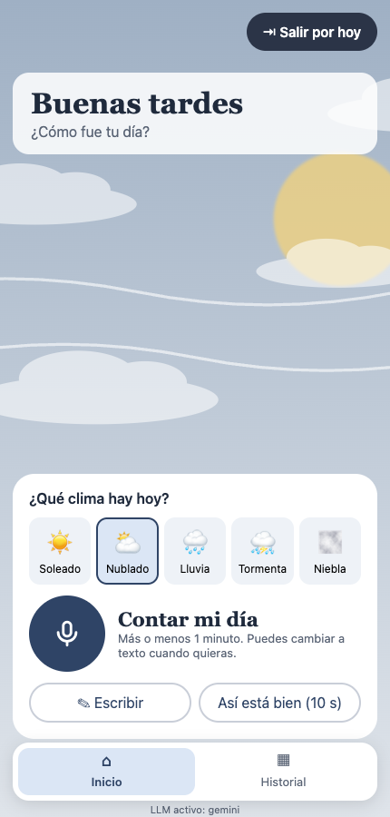
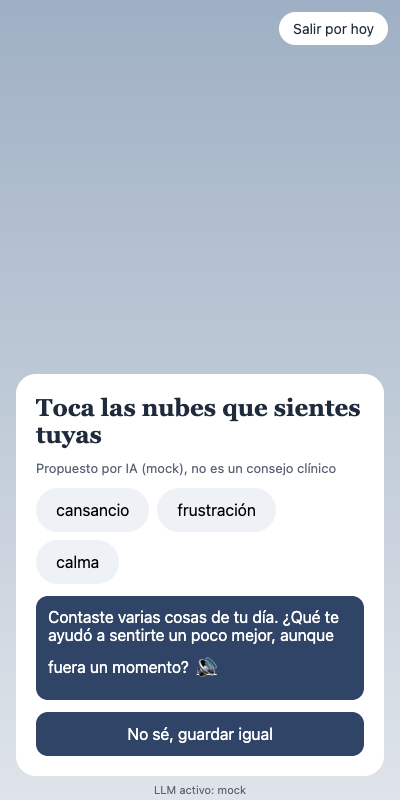
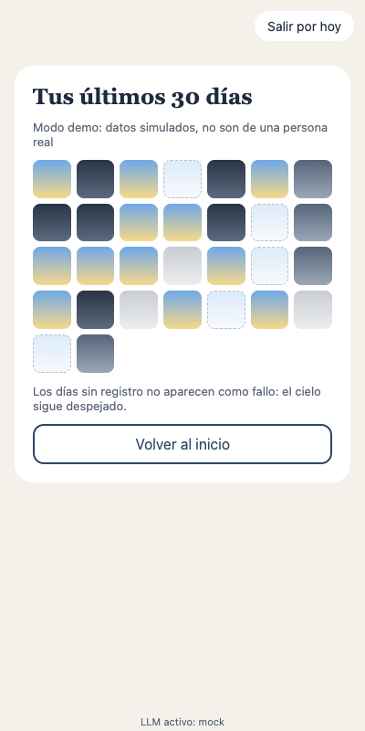

# Clima Interior · diario emocional generativo

Cuenta cómo fue tu día en un minuto y míralo convertido en un clima. La app te propone palabras para lo que
sientes, y tú decides cuáles son tuyas.

Proyecto del curso **CC451 Interacción Humano-Computador**, Universidad Nacional de Ingeniería, 2026-2.
**Grupo 8:** Melissa Iman Noriega · Benjamin Seminario Serna · Ivette Mera Amado.

| Inicio | Emociones propuestas | Historial demo |
|---|---|---|
|  |  |  |

## Qué hace

1. Eliges el clima del día: soleado, nublado, lluvia, tormenta o niebla. Si no tienes ganas de hablar, con eso basta.
2. Si quieres, lo cuentas por voz o lo escribes. Puedes corregir la transcripción antes de que la lea la IA.
3. Antes de llamar a la IA se revisa si hay frases de riesgo. Si las hay, la app muestra la Línea 113 (opción 5), el SAMU 106 y la PNP 105, y no genera reflexión.
4. La IA propone emociones y tú eliges las tuyas o marcas "no sé". Lo que infiere la IA no reemplaza lo que eliges.
5. Ves una reflexión corta, que también se puede escuchar.
6. El historial de ejemplo muestra 30 días simulados.

## Requerimientos del proyecto y dónde están

| Requerimiento | Cómo se cumple | Estado |
|---|---|---|
| Interfaz de voz | STT y TTS con Web Speech API (`src/voz/stt.js`) | Hecho |
| LLM con capa de abstracción | Contrato común + proveedores `mock`, `ollama`, `remoto` (`src/llm/`) | Hecho |
| PWA | `vite-plugin-pwa`: instalable, service worker, offline | Hecho |
| Personalización continua | Perfil persistente con registros y hora habitual (`src/datos/perfil.js`) | Básico |
| Multiusuario | Salas por código con Supabase Realtime; datos de ejemplo en `public/demo/sala-ejemplo.json` | Diseñado |
| Diseño emocional (Norman) | Visceral: paisaje. Conductual: check-in en menos de 90 s. Reflexivo: historial y patrones | Parcial |

La matriz de trazabilidad completa (44 RF, 32 RNF, 32 historias de usuario) está en
[`docs/matriz-trazabilidad.md`](docs/matriz-trazabilidad.md).

## Instalación

Requisitos: **Node.js 20 o superior** y **Python 3** (solo si quieres regenerar los datos simulados).

```bash
git clone https://github.com/Melissa1221/clima-interior.git
cd clima-interior
npm install
cp .env.example .env      # por defecto usa el proveedor simulado, sin claves
npm run dev               # http://localhost:5173
```

Para probar la PWA instalable y el modo offline, usa la versión compilada:

```bash
npm run build
npm run preview           # http://localhost:4173
```

En Chrome aparece el botón **Instalar** en la barra de direcciones. En el celular, abre la URL y elige
"Agregar a pantalla de inicio". El dictado por voz necesita Chrome o Edge; en otros navegadores la app
ofrece escribir.

### Cambiar de proveedor de LLM

Edita `VITE_LLM_PROVIDER` en `.env`:

| Valor | Qué usa | Necesita |
|---|---|---|
| `mock` | Respuestas simuladas por reglas | Nada (por defecto) |
| `ollama` | Modelo local | [Ollama](https://ollama.com) con `ollama pull llama3.2` |
| `remoto` | Claude o Gemini vía proxy | `VITE_REMOTO_URL` apuntando al proxy que guarda la clave |

Si el proveedor falla, tarda más de 10 s o responde fuera del esquema, la app usa una reflexión local y sigue funcionando.

## Datos simulados

`public/demo/` contiene 30 días (8 sep – 7 oct 2026) de una persona ficticia y una sala de ejemplo con 5
seudónimos. No hay datos reales. Para regenerarlos (semilla fija, siempre salen iguales):

```bash
npm run datos
```

## Documentación

- [Arquitectura (C4)](docs/arquitectura.md)
- [Matriz de trazabilidad](docs/matriz-trazabilidad.md)
- Prototipo de fidelidad media en Figma: *Clima Interior · MVP* (58 pantallas)

## Estructura

```
src/
  App.jsx            flujo del check-in e historial
  llm/               contrato, proveedores e índice con respaldo local
  voz/stt.js         voz a texto y texto a voz
  datos/perfil.js    perfil persistente
  datos/riesgo.js    detector de riesgo y líneas de ayuda
public/demo/         datos simulados
scripts/             generador de datos
docs/                arquitectura, matriz, capturas
```

## Aviso

Clima Interior no es un servicio de salud mental ni reemplaza a un profesional. Si estás en riesgo, llama a la
**Línea 113, opción 5**.

## Licencia

[MIT](LICENSE)
