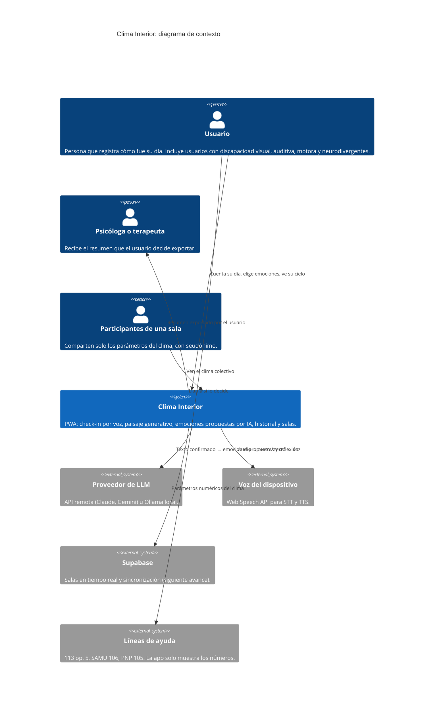
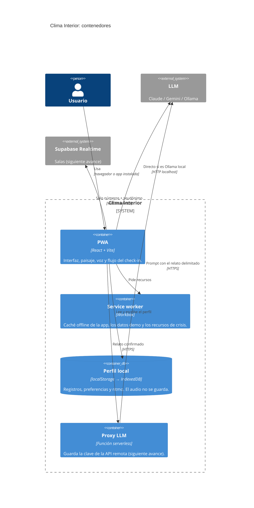
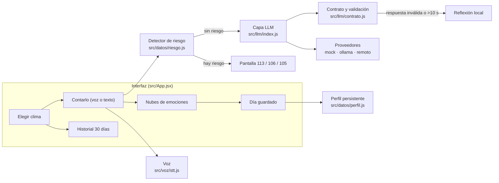

# Arquitectura (modelo C4)

Los diagramas usan la notación C4 de Mermaid, que GitHub muestra directamente.
Las partes marcadas como **(siguiente avance)** están diseñadas pero todavía no están en el código.

## Nivel 1: contexto

Quién usa Clima Interior y con qué sistemas externos se comunica.

## Nivel 2: contenedores

## Nivel 3: componentes de la PWA

## Decisiones de arquitectura

| Decisión | Por qué | Requerimientos |
|---|---|---|
| PWA y no una app nativa | Lo exige el proyecto. Se instala en el celular, funciona offline y no pasa por la tienda de apps | RF-19, RF-20 |
| Capa de abstracción del LLM con contrato común | Cambiar de proveedor es cambiar `VITE_LLM_PROVIDER`, sin tocar la interfaz | RF-18, RNF-22, RNF-23 |
| El detector de riesgo corre antes que el LLM y no depende de él | Si el modelo falla o se equivoca, la derivación igual aparece | RF-14, RNF-25 |
| El relato va delimitado en el prompt | El texto del diario es un dato, no una instrucción (inyección de prompts) | RNF-16 |
| La clave de la API vive en un proxy | Nunca se expone en el navegador | RNF-15 |
| El audio no se guarda; el perfil vive en el dispositivo | Privacidad de datos emocionales | RNF-11, RNF-12 |
| Las salas comparten solo números y seudónimos | Nadie ve el diario de otra persona | RF-27, RNF-13, RNF-14 |
