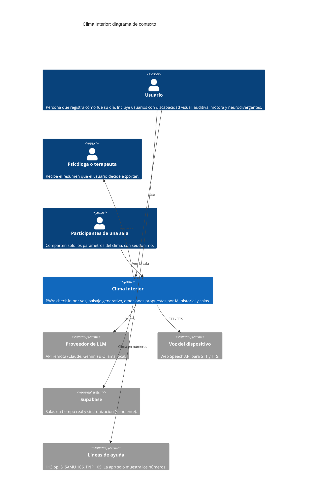
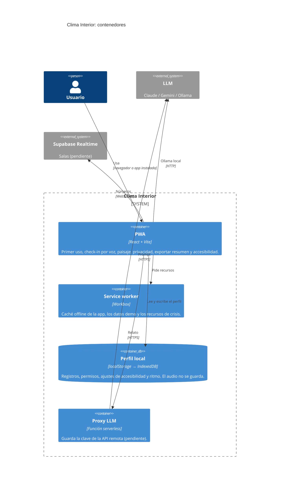
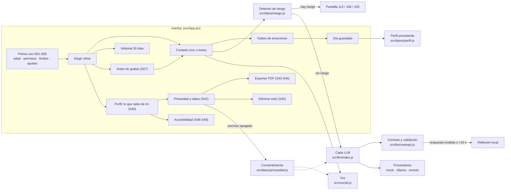
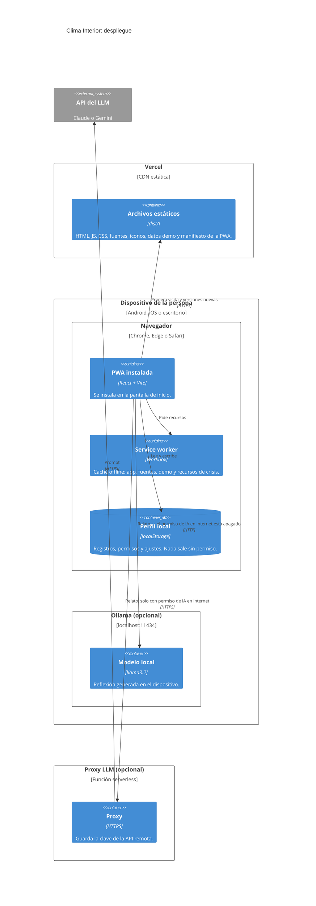

# Arquitectura (modelo C4)

Los diagramas usan la notación C4 de Mermaid, que GitHub muestra directamente.
Las partes marcadas como **(pendiente)** están diseñadas pero todavía no están en el código. El estado de cada requerimiento está en el [reporte de trazabilidad](reporte-trazabilidad.md).

## Nivel 1: contexto

Quién usa Clima Interior y con qué sistemas externos se comunica.

## Nivel 2: contenedores

## Nivel 3: componentes de la PWA

## Despliegue

Cómo llega la PWA al dispositivo. La app es estática: no hay servidor propio ni base de datos; el perfil vive en el navegador de cada persona.

La versión pública usa el proveedor `mock` (sin claves). Una clave `VITE_GEMINI_API_KEY` se incrusta en el bundle y quedaría visible para cualquiera, por eso en producción la clave solo puede vivir en el proxy.

## Decisiones de arquitectura

| Decisión | Por qué | Requerimientos |
|---|---|---|
| PWA y no una app nativa | Lo exige el proyecto. Se instala en el celular, funciona offline y no pasa por la tienda de apps | RF-19, RF-20 |
| Capa de abstracción del LLM con contrato común | Cambiar de proveedor es cambiar `VITE_LLM_PROVIDER`, sin tocar la interfaz | RF-18, RNF-22, RNF-23 |
| El detector de riesgo corre antes que el LLM y no depende de él | Si el modelo falla o se equivoca, la derivación igual aparece | RF-14, RNF-25 |
| El relato va delimitado en el prompt | El texto del diario es un dato, no una instrucción (inyección de prompts) | RNF-16 |
| La clave de la API vive en un proxy | Nunca se expone en el navegador | RNF-15 |
| El audio no se guarda; el perfil vive en el dispositivo | Privacidad de datos emocionales | RNF-11, RNF-12 |
| Cada permiso es independiente y arranca apagado: sin permiso de internet el dictado solo corre en el dispositivo y la IA en la nube se reemplaza por el modelo local | Nada sale del teléfono antes del consentimiento correspondiente | RF-37, RNF-11 |
| El resumen para la psicóloga o el psicólogo se arma en el teléfono y nunca incluye lo que propuso la IA | La persona decide qué comparte y la IA no deja diagnósticos escritos | RF-38, RNF-24 |
| La versión pública es estática y sin claves | Un bundle de navegador no puede guardar secretos; el LLM remoto pasa por un proxy | RNF-15, RNF-22 |
| Las animaciones se apagan con «Movimiento reducido» o la preferencia del sistema | Sin destellos ni movimiento no esencial | RF-32, RNF-07 |
| Las salas comparten solo números y seudónimos | Nadie ve el diario de otra persona | RF-27, RNF-13, RNF-14 |
